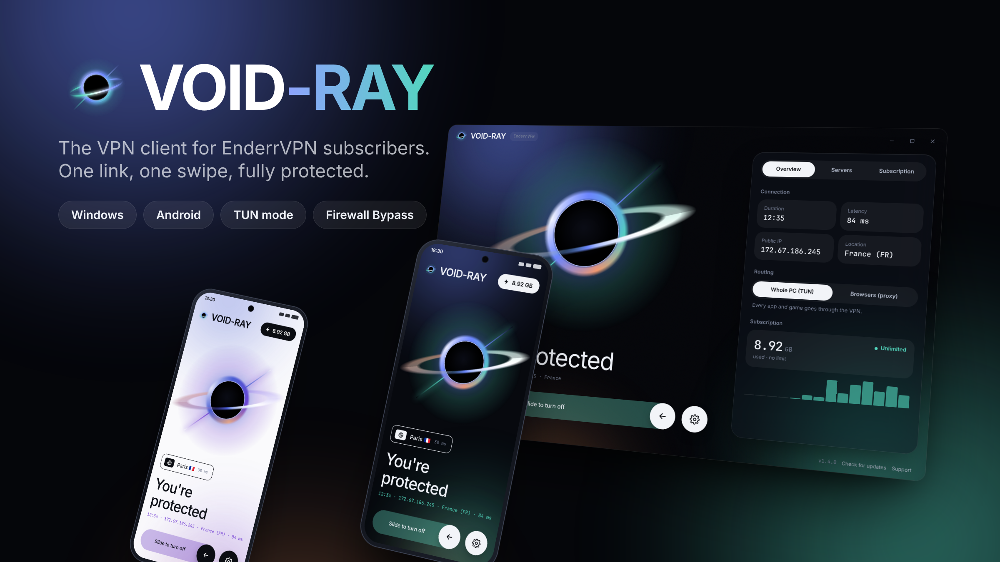
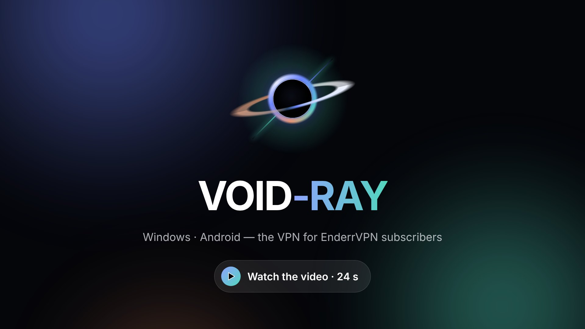
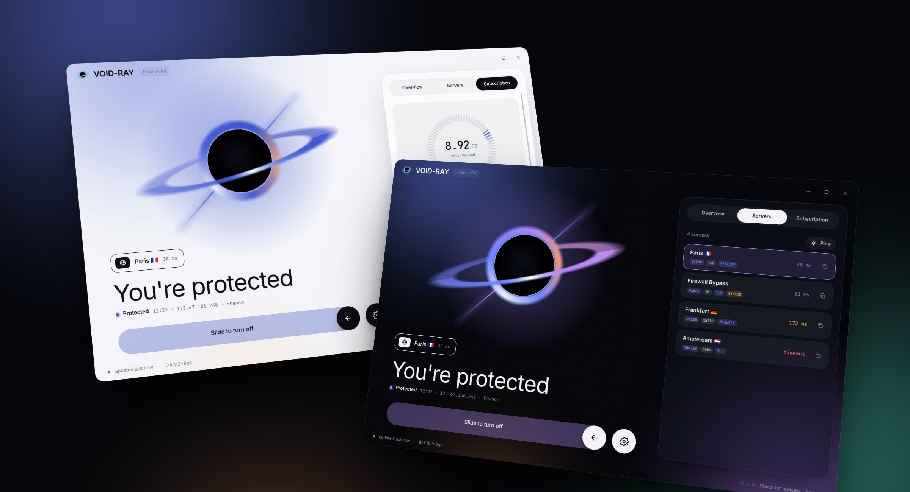
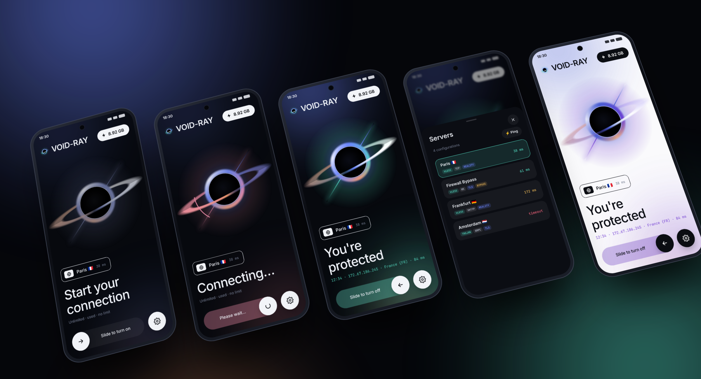

<p align="center">
  
</p>

<h1 align="center">VOID-RAY</h1>

<p align="center">
  <b>The VPN client for EnderrVPN subscribers — Windows &amp; Android.</b><br>
  One link, one swipe, fully protected.
</p>

<p align="center">
  <a href="https://github.com/EnderMythex/VOID-RAY/releases/latest"></a>
  
  
</p>

---

## Trailer

<p align="center">
  <a href="docs/media/voidray.mp4"></a>
  <br><sub>▶ Click to watch the video (24 s)</sub>
</p>

## Download

| Platform | File |
| --- | --- |
| **Windows 10 / 11** | [`VoidRay-win-x64.exe`](https://github.com/EnderMythex/VOID-RAY/releases/latest/download/VoidRay-win-x64.exe) — a single exe, nothing to install |
| **Android (most phones)** | `VoidRay-android-arm64-v8a.apk` in the [latest release](https://github.com/EnderMythex/VOID-RAY/releases/latest) |
| **Android (all devices)** | `VoidRay-android-universal.apk` in the [latest release](https://github.com/EnderMythex/VOID-RAY/releases/latest) |

On first launch, paste your subscription link `https://sub.enderr.win/ender/…`.
Only valid EnderrVPN links are accepted, and everything else configures itself.

## On PC

<p align="center">
  
</p>

- **Your whole PC goes through the VPN (TUN mode)**: games (Minecraft…), launchers,
  Discord. A virtual network adapter called "VOID-RAY" is created by
  [sing-box](https://github.com/SagerNet/sing-box), which hands everything to
  [Xray-core](https://github.com/XTLS/Xray-core). The app restarts as administrator
  when needed and connects right away.
- **Browsers mode (proxy)**: only sets the system proxy, no admin rights needed.
- **System tray**: closing the window keeps the VPN running. Click the icon to reopen
  it, right-click to connect / disconnect or quit. A green dot shows when the VPN is on.
- Live upload / download speed, public IP, country and real latency through the tunnel.
- Built-in log to troubleshoot connection issues.

## On Android

<p align="center">
  
</p>

- **Swipe to connect** around the black hole; servers and subscription details open
  in swipe-down sheets.
- **Live speed in the notification** (↑ / ↓ per second and session totals), with a
  disconnect button.
- **Quick Settings tile** to connect or disconnect without opening the app.
- The VPN uses Android's `VpnService` and Xray-core (`libv2ray.aar`) with its TUN inbound.

## On both

- **Automatic subscription info**: profile, username, status, data used / quota,
  expiry date, announcement, support and website links.
- **Server list** with ping test.
- **Automatic Firewall Bypass**: the "Firewall Bypass" server is rewritten to go through
  Cloudflare (`172.67.186.245:443`, WebSocket + TLS, SNI / Host `xray.enderr.win`,
  path `/x7k2p` or the one from the subscription, `chrome` fingerprint, ALPN `http/1.1`).
- **Dark / light / auto theme**, **6 accent colours**, English / French.
- **Built-in updates**: *Check for updates* reads the latest GitHub release and installs
  it (the PC replaces its exe and restarts, Android opens the installer).

Protocols: `VLESS` (REALITY, TLS, Vision), `VMess`, `Trojan`, `Shadowsocks` (including
2022), over TCP, WebSocket, gRPC, HTTPUpgrade, XHTTP and mKCP. Xray JSON subscriptions
are supported too.

## Build

### Windows (Rust + Tauri v2)

Requirements: Windows 10/11, [Rust](https://rustup.rs) and Node.js (for the Tauri CLI).

```powershell
cd desktop
npx @tauri-apps/cli@2 build --no-bundle
```

The executable ends up in `desktop\src-tauri\target\release\VoidRay.exe`.
`xray.exe` and `sing-box.exe` (pinned versions) are downloaded on first use into
`%AppData%\VoidRay\core`. Settings live in `%AppData%\VoidRay\settings.json`.

### Android (Kotlin + Jetpack Compose)

Requirements: Android SDK and JDK 17.

```bash
curl -L -o android/app/libs/libv2ray.aar \
  https://github.com/2dust/AndroidLibXrayLite/releases/latest/download/libv2ray.aar
cd android && ./gradlew assembleRelease
```

## Releasing

1. Update `.github/release-notes.md` (shown in the release and in the app).
2. **Actions → Release → Run workflow** and enter the version (e.g. `1.4.0`), or push a
   `v1.4.0` tag.

The workflow builds `VoidRay-win-x64.exe` and the `VoidRay-android-*.apk` files, then
creates the release. The version must be higher than the previous one (Android refuses
to install an older version). The repo must be public so users can download updates.

## Project layout

```
desktop/                 Windows app (Rust + Tauri v2)
├── src-tauri/src/       app (commands), subscription, links (vless/vmess/trojan/ss),
│                        config (Xray / sing-box, Firewall Bypass), cores (processes),
│                        system (proxy, elevation), tray, net (ping, IP, updates)
└── ui/                  index.html, style.css, app.js, i18n.js
android/                 Android app (Kotlin + Compose)
└── app/src/main/java/win/enderr/voidray/
    ├── core/            LinkParser, SubscriptionFetcher, XrayConfig, FirewallBypass
    ├── ui/              Home (black hole, swipe to connect), Screens, Theme
    └── vpn/             VoidRayVpnService, Quick Settings tile
src/VoidRay/             Legacy Windows app (WPF / .NET 8), replaced by desktop/
```
